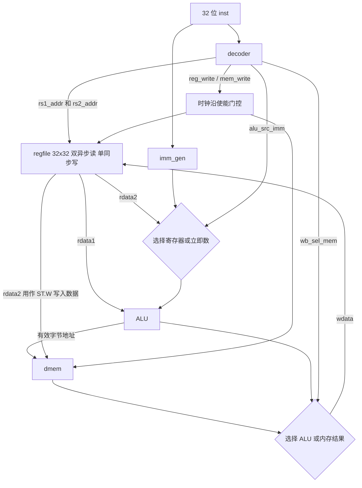

# LoongArch-Pipeline-CPU：第一轮数据通路集成说明（V0.1）

**目标**：在不改动队员 A 的 ALU、不提前覆盖其 `regfile.v` 的前提下，验证 13 条指令的译码、寄存器堆读写、立即数运算、数据存储器读写与写回连接。

**范围说明**：这里是**单周期功能集成原型**（指令从 `inst` 外部送入），不是完整 LoongArch CPU，不包含 PC / IMEM / 分支控制，也不是五级流水线。它用于先发现接口接错、写回错误和 `ST.W` 数据源错误。

## 一、数据通路结构



## 二、公共模块连线约定

| 起点 | 终点 | 说明 |
|---|---|---|
| `decoder.rs1_addr` | `regfile.raddr1` | 普通指令和访存使用 rj，LU12I 无需读取 |
| `decoder.rs2_addr` | `regfile.raddr2` | 3R 使用 rk；**ST.W 使用 rd 字段** |
| `decoder.rd_addr` | `regfile.waddr` | 仅 `reg_write=1` 且非 r0 时生效 |
| `regfile.rdata1` | `alu.a` | 第一 ALU 操作数 |
| `regfile.rdata2` / `imm_gen.imm` | ALU B MUX | 由 `alu_src_imm` 选择 |
| `decoder.alu_op` | `alu.alu_op` | 与 cpu_defs.vh 保持一致 |
| `alu.result` | `dmem.addr` | **字节地址**；本阶段只测试 4 字节对齐 |
| `regfile.rdata2` | `dmem.wdata` | ST.W 写入的 32 位数据 |
| `decoder.mem_write` | `dmem.we` | 还需 exec_en、valid、!rst 门控 |
| `dmem.rdata` / `alu.result` | WB MUX | LD.W 选择存储器结果 |
| WB MUX | `regfile.wdata` | 写回数据 |

重要：**`regfile.waddr` 必须取写回阶段的目的寄存器编号**。当前是单周期，所以直接连 `decoder.rd_addr`；未来改成五级流水线后，需要把目的寄存器编号以及写回控制信号随流水线寄存器向 WB 阶段传递，不能保持该直接连接。

## 三、当前测试工作方式

`exec_en` 由 Testbench 控制，使某个指令只在一个时钟上升沿提交一次；`exec_en=0` 时可以观察组合读取值而不发生寄存器或数据存储器写入。

- 寄存器堆：上升沿同步写，两个读端口组合异步读；高电平同步复位，r0 恒 0。
- 数据存储器：本项目现有 `dmem.v` 上升沿同步写、组合异步读，无复位清空要求。
- 一条指令在上升沿之前稳定；同一上升沿寄存器写回或内存写入。下一条指令在随后下降沿输入。
- 这个时序在功能仿真中用于快速验证连接，不保证能作为 FPGA 的最终时序结构。特别是组合内存读与写回路径将来可能要改为流水线/BRAM 协议。

## 四、测试项与验收

`tb_datapath_stage1.v` 内置：

- 25 条有效指令执行检查；覆盖所需 13 种指令类型。
- 23 次寄存器读口检查；确认读出的寄存器实际内容，而不是窥视 regfile 内部数组。
- 3 条暂不支持的指令，验证不会误触发写操作。
- 关键场景：`LU12I.W + ORI` 构造常量、逻辑运算、符号/无符号立即数、移位 0/31、r0 写入保护、ST.W 数据来自 rd、LD.W 写回、负偏移内存地址、连续依赖指令。

因此总自检调用数为 **51 项**。**预期**（尚需在 Vivado 实际运行）：

```text
Total tests  = 51
Total errors = 0
ALL TESTS PASSED
```

如果只使用 `sim_reference/regfile.v` 通过，结论仅为**参考 regfile 版本集成通过**；必须在队员 A 的正式 `regfile.v` 完成后将其替换、重跑，以检验双方真实接口。

## 五、交叉验证后仍需补充

1. A 的 `tb_regfile.v` 独立测试：32 寄存器、r0、复位优先级、读写边界。
2. 同步复位周期的读行为；复位后 r0/任意寄存器为 0。
3. 流水线引入后对 RAW 数据冒险、load-use、分支冲刷进行单独测试。本阶段相邻指令验证不能替代五级流水线的前递和停顿验证。
4. 统一 `decoder.v` 的所有 ≥25 条指令、非法指令处理、分支和目的寄存器选择。
5. FPGA 实现阶段审核 `dmem` 异步读取对 BRAM 推断/时钟时序影响，并添加访存对齐检查。

## 六、下一轮 Git 协作

- `rtl/common/datapath_stage1.v` 是**阶段性集成原型**，建议由 A、B 共同审核。
- `sim_reference/regfile.v` **仅供仿真**，不应作为正式团队 regfile 模块提交到 `rtl/common`。
- 建议先将本阶段文件保留在 `feature/memory`；通过集成仿真后开 PR，审核无冲突再合并到 main。
- 如队员 A 已开始设计 CPU 顶层或同名模块，先比较路径与端口，避免抢改共享文件。
